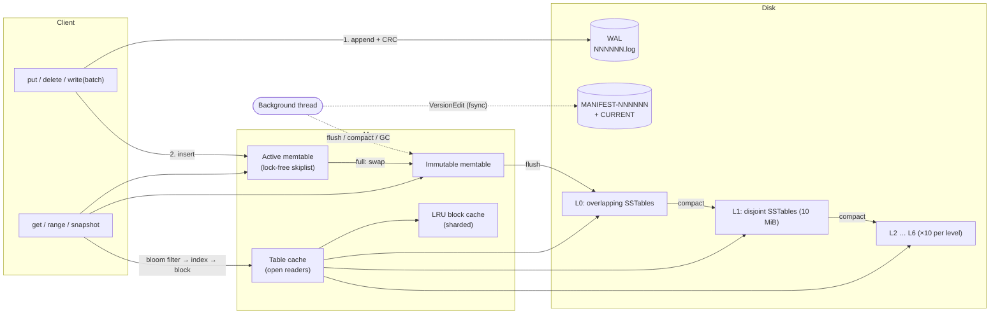

# lsm-engine


`lsm-engine` is an embeddable, crash-safe key-value storage engine written in Rust, built on a
log-structured merge tree in the spirit of LevelDB and RocksDB. Writes go to a CRC-checksummed write-ahead log
and a lock-free skiplist memtable. A background thread flushes memtables into immutable, prefix-compressed,
bloom-filtered SSTables and merges them down a leveled hierarchy. Every metadata change is committed atomically
through a manifest log. 56-bit sequence numbers give readers MVCC snapshots that are isolated from concurrent
writers and compactions. The engine is about 5,000 lines of dependency-light, `unsafe`-free Rust (docs and CLI included) plus about
2,000 lines of tests. It is validated by model-based property tests, a differential fuzzer, and crash tests
that `SIGKILL` a writer process mid-flight. It is benchmarked against [`sled`](https://github.com/spacejam/sled)
on the same machine.

## Features

- **Write-ahead log** with per-record CRC32, and recovery that tells a *torn tail* (crash mid-append) apart from
  real corruption. Three recovery modes: tolerate a corrupted tail (default), absolute consistency, and
  point-in-time.
- **Memtable**: a concurrent skiplist (`crossbeam-skiplist`). Readers never block on writers. When it fills, it
  becomes the immutable memtable and is flushed to level 0 in the background.
- **SSTables**: 4 KiB data blocks with prefix compression and restart points, an index block with shortened
  separator keys, a whole-table bloom filter (10 bits/key, about 1% false positives), per-block CRC32, and a
  versioned, checksummed footer with a magic number.
- **Leveled compaction** on a background thread. Level 0 is scored by file count and deeper levels by byte
  budget (10 MiB × 10ⁿ⁻¹). It uses round-robin compaction pointers, trivial moves, grandparent-overlap limits
  on output files, and backpressure (slowdown and stop triggers on level 0).
- **Manifest / version set**: atomic metadata changes through `VersionEdit` records, with `CURRENT` swapped by
  `rename`. Ref-counted versions keep the files a reader still needs alive.
- **MVCC**: sequence numbers, tombstones, and RAII `Snapshot`s. Compaction drops shadowed versions and
  tombstones only when no snapshot can observe them.
- **API**: `put` / `get` / `delete`, atomic `WriteBatch`, ordered range scans (`db.range(a..b)`) over a k-way
  merging iterator across memtables and all levels, snapshots, `flush`, `compact_range`, and statistics
  including write amplification.
- **Block cache**: a sharded LRU (slab-backed intrusive list, no `unsafe`) shared by all tables, plus a cache
  of open table readers bounded by `max_open_files`.
- **Configurable** through `Options` (buffer sizes, level fan-out, block size, restart interval, bloom
  bits/key, cache size, checksum verification, WAL recovery mode, and more).
- **CLI** (`lsm`) for get, put, scan, bulk loads, compaction and stats, plus `dump-sst` and `dump-wal` to
  inspect the on-disk formats.

## Quick start

```rust
use lsm_engine::{Db, Options, ReadOptions, WriteBatch};

let db = Db::open("/tmp/my-db", Options::default())?;

db.put(b"user:1", b"alice")?;
db.put(b"user:2", b"bob")?;
assert_eq!(db.get(b"user:1")?, Some(b"alice".to_vec()));

// Atomic: after a crash either both operations are present or neither is.
let mut batch = WriteBatch::new();
batch.delete(b"user:1");
batch.put(b"user:3", b"carol");
db.write(batch)?;

// Snapshot isolation: the snapshot keeps seeing the old state.
let snap = db.snapshot();
db.put(b"user:2", b"robert")?;
assert_eq!(db.get_opt(b"user:2", &ReadOptions::at_snapshot(&snap))?, Some(b"bob".to_vec()));

// Ordered range scan, merged across memtables and every level.
for kv in db.range(b"user:".to_vec()..b"user;".to_vec()) {
    let (key, value) = kv?;
    println!("{} = {}", String::from_utf8_lossy(&key), String::from_utf8_lossy(&value));
}
```

The same code is in [`examples/quickstart.rs`](examples/quickstart.rs) (`cargo run --example quickstart`).

CLI:

```console
$ cargo build --release
$ ./target/release/lsm --db /tmp/demo load --count 200000 --random
$ ./target/release/lsm --db /tmp/demo scan --start key0000000000000100 --limit 3
$ ./target/release/lsm --db /tmp/demo compact
$ ./target/release/lsm --db /tmp/demo stats
$ ./target/release/lsm dump-sst /tmp/demo/000049.sst --limit 5
```

## Architecture



**Write path.** A writer takes the writer mutex and makes room: if the memtable is full it switches to a fresh
memtable and WAL, waiting if the previous flush has not finished or level 0 is at its stop limit. The writer
then assigns the batch a contiguous range of sequence numbers, appends the serialized batch to the WAL as **one
record** (one `write(2)`, plus `fdatasync` if `sync` is set) and inserts it into the skiplist. Last, it
publishes the new `last_sequence` with a release store. Readers ignore entries above the sequence they
captured, so a batch becomes visible all at once.

**Read path.** A reader captures `(last_sequence, memtable, immutable memtable, current Version)` under the
state mutex. That is four pointer copies; all reading happens after the lock is released. A point lookup
checks the memtable, then the immutable memtable, then the level-0 files newest-first, then at most one file
per deeper level found by binary search on key ranges. In each file the bloom filter is checked first, then the
index block, then a single data block, which comes from the cache when possible. Range scans merge all of these
sources with a k-way `MergingIterator`. On top of that, `DbIterator` hides entries newer than the snapshot,
collapses multiple versions of a key to the newest one, and skips keys whose newest version is a tombstone.

**Background work.** One thread flushes the immutable memtable (always first, since writers may be stalled on
it), then runs manual compactions, then picks automatic compactions by score. A compaction merges its inputs
and drops a version when a newer version of the same key is at or below the oldest live snapshot. It drops a
tombstone when, in addition, no deeper level can contain the key. The resulting `VersionEdit` is appended to the
manifest and `fsync`ed before the new version is installed. Afterwards, files that no live version, WAL or
manifest references are deleted.

**Recovery.** `CURRENT` names the manifest. Replaying its edits rebuilds the file layout and the counters
(`log_number`, `next_file_number`, `last_sequence`). Every WAL numbered `>= log_number` is replayed into
memtables and flushed to level 0. A fresh WAL and a compacted manifest are then committed in a single
`VersionEdit`, and orphaned files (for example, a table from a flush that crashed before its manifest commit)
are collected.

## On-disk format

All integers are little-endian. "varint" is LEB128 (7 bits per byte, the high bit means "more bytes follow").

### Directory layout

| File | Purpose |
|---|---|
| `CURRENT` | Name of the live manifest plus `\n`. Replaced atomically: write temp file, `fsync`, `rename`, `fsync` the directory. |
| `LOCK` | Advisory `flock` held while the database is open, which rejects a second opener. |
| `MANIFEST-NNNNNN` | Log of `VersionEdit` records, in WAL record format. |
| `NNNNNN.log` | Write-ahead log for one memtable. |
| `NNNNNN.sst` | SSTable. |

All numbered files share one counter, so a number never identifies two different files.

### Log record (WAL and manifest)

```text
+-------------+--------------+----------------------+
| crc32 (u32) | length (u32) | payload (length B)   |
+-------------+--------------+----------------------+
crc32 = CRC-32/IEEE over the 4 length bytes followed by the payload
```

On replay, a partial header, a partial payload, or a bad checksum on the *last* record (or a record followed
only by zeros) is a **torn tail**. It is dropped in the default mode and the dropped bytes are reported in
`DbStats::recovery`. A bad record with valid data after it is **corruption**, which fails `open` unless
`PointInTimeRecovery` is selected.

### Write batch (WAL payload)

```text
batch  := sequence (u64) | count (u32) | record*
record := 0x01 | varint klen | key | varint vlen | value      -- put
        | 0x00 | varint klen | key                           -- delete
```

### Internal key

```text
internal_key := user_key | trailer (u64)      trailer = (sequence << 8) | type   (type: 0 = deletion, 1 = value)
order        := user_key ascending, then trailer descending (newest version first)
```

### SSTable

```text
+------------------------+
| data block 0           |  entries sorted by internal key
| trailer: type | crc32  |  1 + 4 bytes; crc32 over block contents + type byte
+------------------------+
| ...                    |
+------------------------+
| filter block + trailer |  bloom filter over every user key in the table
+------------------------+
| index block + trailer  |  per data block: separator key -> varint offset | varint size
+------------------------+
| footer (48 bytes)      |
+------------------------+

footer := filter_offset u64 | filter_size u64 | index_offset u64 | index_size u64
        | format_version u32 (= 1) | crc32 of the preceding 36 bytes u32 | magic u64 ("LSMTABLE")
```

**Block** (data and index):

```text
block := entry* | restart_offset (u32)* | num_restarts (u32)
entry := varint shared | varint non_shared | varint value_len | key[shared..] | value
```

Each key stores only the bytes that differ from the previous key. Every 16 entries (`block_restart_interval`)
the prefix resets to empty and the entry's offset is recorded as a restart point. A seek binary-searches the
restart points and then scans forward linearly. Index entries use a restart interval of 1 so the search is a
pure binary search, and their keys are *shortest separators*: for `abcdefg | abzzz` the index key is `abd`.

**Bloom filter**: `bits[ceil(n·bits_per_key/8)] | k (u8)`. It is built from one 32-bit Murmur-style hash per
key with double hashing (`h += rotr(h, 17)` per probe), and `k = round(0.69 · bits_per_key)`. Malformed filters
fail open, so a damaged filter can never cause a false miss.

### Version edit (manifest payload)

A sequence of `varint tag | payload` fields:

| Tag | Field | Payload |
|---|---|---|
| 1 | comparator | length-prefixed name (checked on open) |
| 2 | log_number | varint: WALs below this are obsolete |
| 3 | next_file_number | varint |
| 4 | last_sequence | varint |
| 5 | compact_pointer | varint level, length-prefixed internal key |
| 6 | deleted_file | varint level, varint file number |
| 7 | new_file | varint level, varint number, varint size, length-prefixed smallest and largest internal keys |

Each new manifest starts with a snapshot edit describing the full current state, followed by deltas. Manifests
rotate on every open and once they exceed `max_manifest_file_size`.

## Design decisions and tradeoffs

| Decision | Why | Cost |
|---|---|---|
| One WAL record per batch, with no 32 KiB block framing (unlike LevelDB) | Simpler format. A torn tail can be found by look-ahead because logs are bounded by the memtable size and read whole at recovery. | A corrupt length field mid-log cannot be resynchronized past. Recovery fails unless point-in-time mode is used. |
| `sync = false` still issues one `write(2)` per batch | An acknowledged write survives a **process** crash (verified by the `SIGKILL` test). | About 1 µs per write versus engines that buffer in user space. Power-loss durability needs `sync = true` or periodic syncs. |
| Single writer mutex, no group commit | Easy to reason about; batch atomicity and sequence assignment are trivially correct. | `sync = true` throughput is bounded by `fsync` latency per batch. Group commit is the obvious next step. |
| Mutex released during manifest `fsync` | Moving the manifest write out of the critical section raised `fillrandom` throughput **about 5×** on macOS, where `fsync` is `F_FULLFSYNC`. It is safe because only the background thread applies edits. | Edits must be prepared, written, then installed in three phases. |
| Read view captured atomically under the state mutex | Compaction may drop versions older than `last_sequence` at its start. A reader that sees the post-compaction version must also hold a sequence at least that new. Taking both under one lock guarantees this. | Every read takes a mutex briefly (no I/O under it). |
| Snapshot creation linearized with the "oldest snapshot" query | Otherwise a compaction could compute "no snapshots" just before a snapshot pins an older sequence, and drop data that snapshot needs. | A tiny critical section on snapshot create and drop. |
| Compaction output files are cut only between distinct user keys | Keeps the user-key ranges of files in a level disjoint, so a point read touches at most one file per level and the invariant is easy to check (checked on every version build). | Files can slightly exceed `target_file_size` when one key has many versions. |
| Level-0 compaction takes *all* level-0 files; manual compaction widens level-0 inputs transitively | Never moves newer level-0 data below older overlapping data. | Larger level-0 compactions under random writes. |
| Memtable is `crossbeam-skiplist`, with an iterator that copies in batches of 64 and re-seeks | Lock-free reads with no `unsafe` in this crate. Skiplist entries borrow the map, so an owning iterator would otherwise need self-reference. | One extra `O(log n)` seek per 64 entries scanned and one copy per entry. An arena skiplist would avoid both. |
| No block compression | Keeps the focus on the LSM machinery. The trailer's compression byte reserves room for adding it without a format change. | Larger files and more I/O than LevelDB with Snappy. |
| Linear-scan `MergingIterator` | Children number fewer than about 15 (memtables, level-0 files, one per level), and a linear scan beats a heap at that size. | Gets worse with many level-0 files, which backpressure bounds. |
| Whole-table bloom filter | One filter probe per table. | The whole filter is pinned in memory, about 1.25 bytes per key. |

## Testing

```console
$ cargo test                       # everything below except the soak and fuzz runs
$ cargo test --release             # same, optimized
$ PROPTEST_CASES=1000 cargo test --release --test model   # deeper model-based soak
$ LSM_CRASH_SEED=7 cargo test --release --test crash survives_sigkill_during_writes
```

| Suite | What it checks |
|---|---|
| Unit tests (`src/**`) | Varint and coding round-trips; internal-key ordering and separator bounds; WAL truncation at every byte offset and in every recovery mode; batch encoding; block and table round-trips and seeks against a model; bloom false-positive rate; LRU behaviour against a model; version-edit round-trips; manifest replay and rotation; level-0 overlap expansion; obsolete-file GC; iterators pinning files during compaction; snapshots surviving compaction. |
| Decoder robustness (proptest) | Arbitrary bytes fed to the block, table, footer, WAL, batch and version-edit decoders must return errors and never panic. |
| `tests/model.rs` | Model-based property test: random sequences of put, delete, batch, get, scan, snapshot create/read/drop, flush, ranged compaction and **reopen** run against both the engine and a `BTreeMap`, with tiny buffers so flushes and multi-level compactions happen constantly. Plus a 24k-operation deterministic workload with restarts. |
| `tests/crash.rs` | Simulated crashes: WAL truncated at every byte of the last 120 bytes and at a 37-byte stride through the rest, then garbage tails, zero-filled tails, and mid-log bit flips in each recovery mode. After each, exactly a *prefix* of batches must be recovered, every batch complete. Real crashes: a child process writes continuously under tiny buffers (so flushes and compactions are in flight) and is `SIGKILL`ed at a random moment, six times in a row. Every acknowledged write must survive and nothing after the recovered prefix may appear. Also: orphaned tables are collected, and a corrupted SSTable surfaces as `Error::Corruption`. |
| `tests/api.rs` | Public API end to end, including concurrent writers and readers, and a bank-transfer invariant (concurrent atomic batches, with snapshots and scans that must always see the same total). |
| `fuzz/` | `cargo fuzz run decoders` (structure-unaware bytes into every decoder) and `cargo fuzz run db_ops` (differential fuzzing against a `BTreeMap`, including reopen). |

## Benchmarks

All numbers below were **measured on this machine by `benches/db_bench.rs`**. None are copied or estimated.

**Setup.**

- Hardware and toolchain: Apple M4 (10 cores), 16 GB RAM, APFS SSD, macOS (Darwin 25.4), Rust 1.99
  (`--release`).
- Engines: `lsm-engine` with default `Options`, and `sled 0.34.7` with default configuration. Both have a 64 MiB
  cache. Neither engine `fsync`s individual writes: `lsm-engine` uses `sync = false`, which still performs one
  `write(2)` per batch; sled flushes its log periodically in the background.
- Workload: 16-byte keys and 100-byte incompressible values. `fillseq` inserts keys in order. `fillrandom`
  inserts every key exactly once in shuffled order. `overwrite` does N uniformly random updates on the
  `fillrandom` database. `readrandom` reads existing keys and `readmissing` reads absent ones. `seekrandom`
  seeks to a random key and reads the next 100 entries. `readseq` is a full scan. Timings cover only the
  operation loop; background flush and compaction time after a fill is reported separately as `settle` in the
  raw output.

**Conditions.** The machine was otherwise idle (only an unrelated, mostly idle VM was running). A sampler
recorded the 1-minute load average every 15 s throughout: **1.7 to 2.8 on 10 cores** (2026-10-15, 13:01–13:05).
The engines were run **interleaved** (lsm, sled, lsm, sled, …), three runs each, and every figure is the
**median** with the min–max range in parentheses. Raw output for every run and the load samples are in
[`benches/results/`](benches/results/).

**1M keys (about 130 MiB of SSTables, twice the cache size).** Median of 3 interleaved runs per engine:

| benchmark | lsm-engine ops/s (min–max) | sled ops/s (min–max) | lsm / sled | lsm p50 / p99 µs | sled p50 / p99 µs |
|---|---:|---:|---:|---:|---:|
| fillseq | 389k (388k–391k) | 261k (247k–269k) | 1.49× | 1.29 / 3.50 | 0.58 / 21.75 |
| fillrandom | 278k (276k–280k) | 250k (234k–250k) | 1.11× | 1.67 / 4.46 | 1.46 / 24.96 |
| overwrite | 227k (224k–227k) | 177k (171k–177k) | 1.28× | 1.96 / 5.12 | 4.04 / 26.83 |
| readrandom | 568k (562k–574k) | 225k (219k–229k) | 2.53× | 1.58 / 3.42 | 3.58 / 16.12 |
| readmissing | 5.81M (5.59M–5.86M) | 4.52M (4.47M–4.60M) | 1.29× | 0.17 / 0.17 | 0.21 / 0.38 |
| seekrandom (seek + 100 nexts) | 73k (73k–74k) | 20k (20k–20k) | 3.67× | 13.2 / 23.3 | 49.5 / 92.8 |
| readseq (entries/s) | 12.8M (12.7M–13.0M) | 1.63M (1.56M–1.77M) | 7.88× | – | – |

**200k keys (about 26 MiB, fits in the cache).** Median of 3 interleaved runs per engine:

| benchmark | lsm-engine ops/s (min–max) | sled ops/s (min–max) | lsm / sled | lsm p50 / p99 µs | sled p50 / p99 µs |
|---|---:|---:|---:|---:|---:|
| fillseq | 444k (441k–448k) | 709k (707k–715k) | 0.63× | 1.25 / 3.42 | 0.54 / 10.42 |
| fillrandom | 442k (437k–449k) | 507k (498k–514k) | 0.87× | 1.46 / 3.58 | 1.00 / 14.12 |
| overwrite | 364k (358k–373k) | 789k (749k–813k) | 0.46× | 1.50 / 3.71 | 0.96 / 9.96 |
| readrandom | 1.01M (1.00M–1.03M) | 1.88M (1.86M–1.90M) | 0.53× | 0.92 / 2.75 | 0.50 / 0.96 |
| readmissing | 5.86M (5.72M–5.88M) | 4.95M (4.93M–5.11M) | 1.18× | 0.17 / 0.17 | 0.17 / 0.33 |
| seekrandom (seek + 100 nexts) | 83k (82k–84k) | 63k (61k–65k) | 1.33× | 12.1 / 15.7 | 15.8 / 21.1 |
| readseq (entries/s) | 14.6M (14.5M–14.6M) | 6.54M (6.54M–6.64M) | 2.23× | – | – |

**Write amplification** is deterministic for a given workload; it was identical in every run. It is
reported by `DbStats` as SSTable bytes written (flush plus compaction) per user byte:

| workload | 200k keys | 1M keys |
|---|---:|---:|
| fillseq | 1.79× | 1.97× |
| fillrandom | 2.24× | 5.56× |
| overwrite (this phase only) | 2.72× | 7.33× |
| cumulative after fill + overwrite, SSTs only / including WAL | – | 6.44× / 7.64× |

At 1M keys the tree settles at L1 = 5 files, L2 = 51, L3 = 9 (about 128 MiB). Across fill + overwrite, that
run did 119 merging compactions and 21 trivial moves, which read 1.27 GiB and wrote 1.18 GiB, with **zero
write-stall time**. Over the whole run, bloom filters skipped 1.54M table probes, which is why `readmissing`
almost never touches a data block.

**Micro-benchmarks** (criterion, `cargo bench --bench micro`; median of 3 runs on the same idle machine):

| operation | time |
|---|---:|
| bloom filter probe | 17 ns |
| seek within a 4 KiB block (40 entries) | 92 ns |
| table point lookup, block cached (20k-entry table) | 380 ns |
| memtable insert (100-byte value) | 394 ns |
| memtable lookup (100k entries) | 425 ns |
| WAL append, 128 B, no fsync (one `write(2)`) | 1.31 µs |

**Reading the results.**

- *Out of cache, the LSM tree wins.* Point reads are 2.5× faster: a lookup touches at most one block per level,
  and bloom filters skip the rest. Writes are 1.1 to 1.5× faster, and the p99 write latency is 5 to 6× lower
  (sequential appends plus background merging, versus sled's page rewrites). sled has the lower p50 on
  `fillseq` and `fillrandom`.
- *In cache, sled is faster at writes and point reads:* about 1.9× on `readrandom`, about 2.2× on `overwrite`,
  and 1.6× on `fillseq`. An in-memory B-tree page lookup is cheaper than this engine's read path: memtable
  skiplist, then bloom filter, then index block, then data-block decode, then a copy of the value. This
  engine's write floor is the deliberate per-write `write(2)`, measured at 1.3 µs above, which buys
  process-crash durability on acknowledgement; sled buffers its log in user space. The LSM tree still has the
  tighter p99 write latency (about 3.5 µs versus 10 to 14 µs).
- *Scans favour the LSM tree everywhere:* 1.3 to 3.7× for `seekrandom` and 2.2 to 7.9× for `readseq`. Data
  blocks are sorted, contiguous and prefix-compressed.
- An earlier version held the DB mutex across the manifest `fsync`. Moving that I/O out of the critical section
  took 200k-key `fillrandom` from about 60k to about 300k ops/s and cut its p99.9 from 3.6 ms to about 70 µs.
  Both numbers come from an earlier session on a busy machine, so read them as relative, not absolute.

Reproduce:

```console
$ cargo bench --bench db_bench -- --num=1000000                 # both engines, all benchmarks
$ cargo bench --bench db_bench -- --num=200000 --engines=lsm --benchmarks=fillrandom,readrandom
$ cargo bench --bench micro
```

## Limitations and future work

- **Forward iteration only.** `DbIterator` has no `prev` or `seek_to_last`. Adding them requires reverse block
  iteration over restart points and a direction-aware merging iterator.
- **No group commit.** Concurrent `sync = true` writers each pay their own `fsync`. A LevelDB-style writer queue
  that coalesces batches would amortize it.
- **One background thread.** Flushes and compactions are serialized. RocksDB-style subcompactions and parallel
  non-overlapping compactions would raise write throughput on multi-core machines.
- **No compression** and bytewise key order only (no custom comparators).
- **Memtable keys and values are separate heap allocations.** An arena-backed skiplist would improve locality
  and allocation cost on the write path.
- **Whole-file WAL read at recovery.** Bounded by the memtable size today. Streaming reads would be needed for
  very large buffers.
- **Durability on macOS:** Rust's `sync_all` and `sync_data` issue `F_FULLFSYNC`, which is truly durable but
  slow. `fsync`-heavy configurations (tiny write buffers, `sync = true`) are much slower on macOS than on Linux.
- No TTL, column families, transactions beyond atomic batches, or online backup or checkpoint.

## Project layout

```text
src/
  lib.rs            public API re-exports and crate docs
  db/               Db: open and recovery, write path, read path, background work, iterators, snapshots, stats
  version/          Version (file layout), VersionSet (manifest), VersionEdit, compaction picking
  sstable/          block format, bloom filter, table builder and reader, footer
  memtable.rs       skiplist memtable and owning iterator
  wal.rs            checksummed record log (WAL and manifest)
  batch.rs          atomic write batches
  iterator.rs       InternalIterator trait and k-way MergingIterator
  cache.rs          sharded LRU (block cache, table cache)
  key.rs            internal key encoding and ordering
  bin/lsm.rs        CLI
tests/              api, model-based (proptest), crash-recovery
benches/            db_bench (vs sled) and criterion micro-benchmarks
examples/           quickstart
fuzz/               cargo-fuzz targets
```

## License

MIT. See [LICENSE](LICENSE).
